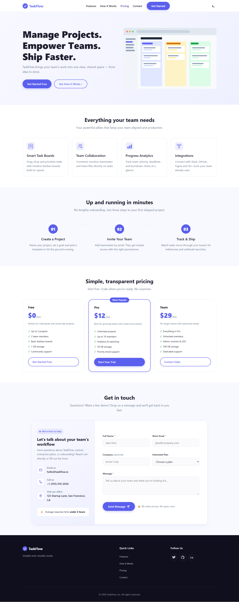
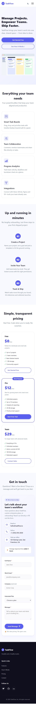
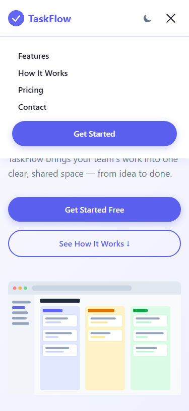

# TaskFlow – Project Management for Modern Teams

> A lightweight, beautiful SaaS landing page built with plain HTML5, CSS3 and vanilla JavaScript.
> Front-end internship assignment for **Sankar Group**.

---

## 🌐 Live Demo

[View Live Demo](#) ← *Replace `#` with your deployed URL after deployment.*

---

## 📸 Screenshots

### Desktop View


### Mobile View


### Mobile Menu Open


---

## ✨ Features

- Fully responsive (320px → 1440px+)
- Smooth scroll navigation with active link highlighting
- Mobile hamburger menu (opens/closes; closes on link click or outside click)
- Pricing cards with preselect-to-form integration
- Form validation (name, email, message) with inline error messages
- Success banner after valid form submission
- Back to Top button (appears after scrolling)
- Fade-in scroll animations
- Dark / Light theme toggle (persisted in localStorage)
- Accessible: semantic HTML, aria labels, focus states, `role="alert"` on errors
- Zero dependencies — no frameworks, no build step

---

## 🛠 Tech Stack

| Technology | Purpose |
|---|---|
| HTML5 | Semantic page structure |
| CSS3 | Styling, layout (Flexbox + Grid), animations |
| Vanilla JavaScript (ES6+) | Interactivity, validation, IntersectionObserver |
| Google Fonts (Inter) | Typography |
| Inline SVG | Icons and hero illustration |

---

## 📁 Folder Structure

```
Assignment/
├── index.html          # Main HTML page
├── css/
│   └── style.css       # All styles (CSS variables, mobile-first, responsive)
├── js/
│   └── script.js       # All JavaScript (modular functions, no dependencies)
├── assets/
│   ├── favicon.svg     # SVG favicon
│   └── og-image.svg    # Open Graph / social share image placeholder
├── screenshots/
│   ├── desktop-full.png
│   ├── mobile-full.png
│   └── mobile-menu.png
├── README.md
└── DESIGN_NOTES.md
```

---

## 🚀 How to Run Locally

**Option 1 — Open directly:**
1. Download or clone the repository.
2. Double-click `index.html` to open it in your browser.
   > ⚠️ Google Fonts loads from the network; you'll need an internet connection for the custom font. The page works fine without it, falling back to system-ui.

**Option 2 — Live Server (recommended for development):**
1. Install the [Live Server](https://marketplace.visualstudio.com/items?itemName=ritwickdey.LiveServer) VS Code extension.
2. Right-click `index.html` → **Open with Live Server**.
3. The page opens at `http://127.0.0.1:5500`.

**Option 3 — Python simple server:**
```bash
# Python 3
cd Assignment
python -m http.server 8080
# Then open http://localhost:8080
```

---

## ☁️ Deployment

### GitHub Pages
1. Push the project to a GitHub repository.
2. Go to **Settings → Pages**.
3. Under **Source**, select **Deploy from a branch**, choose `main`, folder `/` (root).
4. Click **Save**. Your site will be live at `https://<username>.github.io/<repo-name>/` within a minute.

### Netlify (drag & drop — fastest)
1. Go to [netlify.com](https://netlify.com) and sign in.
2. Drag the entire `Assignment` folder onto the Netlify dashboard.
3. Netlify publishes instantly and gives you a URL like `https://taskflow-xyz.netlify.app`.
4. (Optional) Click **Site settings → Change site name** to customise the URL.

### Vercel
1. Install Vercel CLI: `npm i -g vercel`
2. In the `Assignment` folder: `vercel`
3. Follow the prompts. Vercel deploys and gives you a live URL.

---

## 🧠 How I'd Explain This Code

**HTML structure:** The page is one `index.html` file divided into semantic landmarks — a `<header>` (sticky navbar), `<main>` containing six `<section>` elements (hero, features, how-it-works, pricing, contact, and a back-to-top anchor), and a `<footer>`. Every section has a unique `id` for anchor navigation. Forms use proper `<label for="…">` associations and ARIA `role="alert"` on error spans for screen-reader compatibility.

**CSS approach:** Everything starts from a set of CSS custom properties (design tokens) defined on `:root` — colors, spacing in 8 px multiples, typography scale, and shadows. Layout is mobile-first (base styles target 320 px) and uses `min-width` media queries at 480 px, 768 px, 1024 px and 1280 px. Flexbox handles single-axis layouts (navbar, button groups, card interiors) while CSS Grid handles two- and four-column sections. The dark-theme is a single `[data-theme="dark"]` block that overrides the same custom properties, so every component inherits it automatically.

**JavaScript functions:** `script.js` exports nothing and imports nothing — it's a plain IIFE-free module of named functions called from `init()` on `DOMContentLoaded`. `initMobileMenu` toggles classes and `aria-expanded` for the hamburger. `initScrollSpy` uses `IntersectionObserver` to track which section is in view and highlights the matching nav link. `initFormValidation` checks required fields against simple rules (length, regex) and shows/clears inline error messages without any library. `initPricingButtons` reads the `data-plan` attribute on each pricing CTA and writes it into the contact form's plan `<select>` before the browser scrolls to the contact section. `initThemeToggle` reads and writes `localStorage` to persist the user's color scheme preference across page loads.

---

## 📄 License

MIT — free to use, modify, and distribute.
